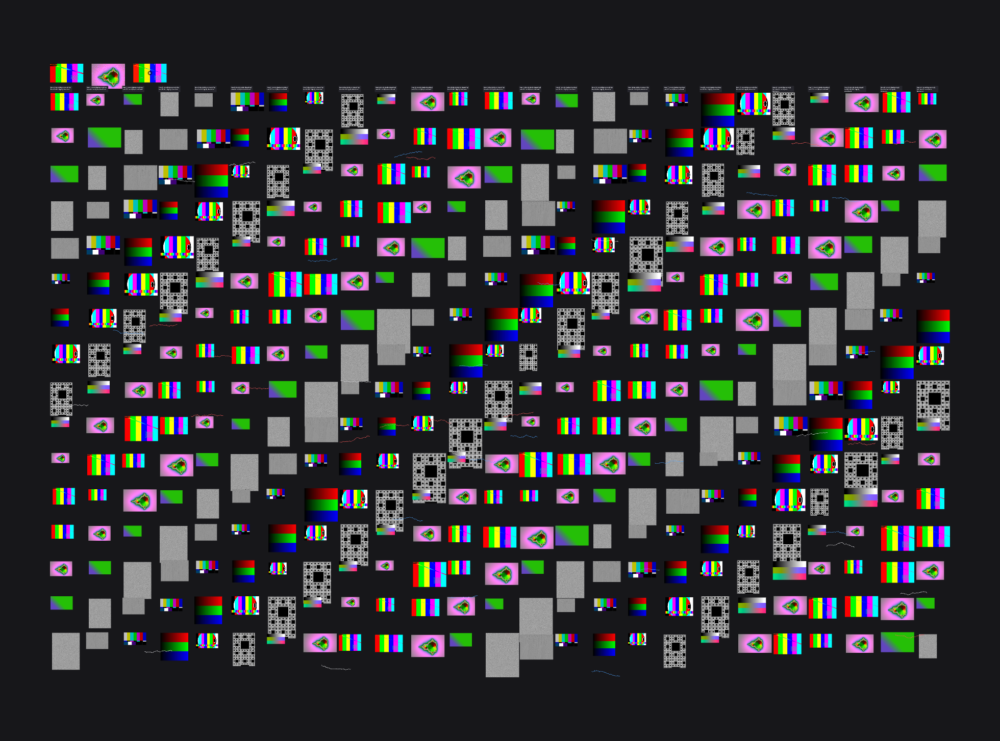
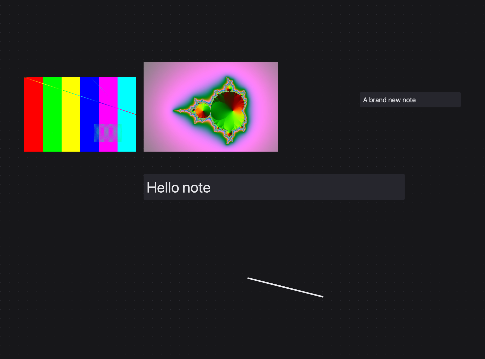
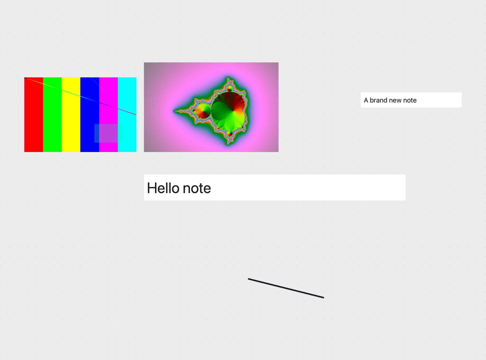

# Moodboard

A local-first, infinite-canvas moodboard for visual development: point it at the folders where your reference art already lives, arrange it freely, and the board remembers the layout. Built for developing an anime's visual world, useful for any reference-heavy project.

- **Your files stay where they are.** A board is a tiny `.mb` JSON file that stores relative paths and positions. Nothing is copied, moved or modified.
- **Double-click a `.mb` file to open that board.** Edits autosave.
- **Fast with big collections.** WebGL canvas, thumbnails and level-of-detail textures; hundreds of large images pan at 60 fps.
- **Private by design.** No account, no network access, no analytics. Everything runs offline.

<p align="center"></p>

<p align="center">
  
  
</p>

*Screenshots show the canvas rendering generated test patterns; the app chrome (toolbar, asset panel) is still being designed.*

## Features

| | |
|---|---|
| **Canvas** | Infinite pan and zoom, drag-to-move, corner handles to resize (aspect locked, Shift to free), z-order |
| **Media** | PNG, JPEG, WebP, GIF (animated), BMP, TIFF, and MP4/MOV/WebM video with native play, scrub and volume controls |
| **Notes** | Double-click empty space to add text. Corner handles scale the whole note, side handles reflow it, `A−`/`A+` set the size |
| **Drawing** | Pen with colours and sizes, eraser. Strokes are ordinary board items: they move, resize, layer and undo like everything else |
| **Selection** | Drag a box, Shift-click, ⌘A; move, delete and reorder as a group |
| **History** | Undo/redo, 200 steps deep |
| **Missing files** | Placeholders instead of crashes; **Relink** one file and similar moves are fixed automatically, or **Find** by filename |
| **Asset browser** | Virtualized, grouped by subfolder with counts, search and type filter. Drag onto the board or double-click |
| **Themes** | Auto (follows macOS), Light, Dark |
| **Shared libraries** | Assets can live next to the board (`./assets`) or in any other folder; the path is stored relative when nearby |

## Quick start

Requires macOS, [Node](https://nodejs.org/) and [Rust](https://rustup.rs/) (`brew install rust` also works).

```sh
git clone <this repo>
cd mood-board
npm install
npm run tauri dev
```

Build an installable app, which also registers double-click-to-open for `.mb` files:

```sh
npm run tauri build -- --bundles app
# -> src-tauri/target/release/bundle/macos/Moodboard.app  (copy to /Applications)
```

## Suggested layout

```
Anime/
  My Show/
    world.mb            <- double-click to open
    characters.mb       <- as many boards as you like
    assets/             <- your existing images, any depth
```

Or keep one shared reference library anywhere and point any board at it with the folder button.

## Shortcuts

| Action | Keys |
|---|---|
| New / open board | ⌘N / ⌘O |
| Select / pen / eraser | `V` / `P` / `E` |
| Add text | `T`, or double-click empty space |
| Undo / redo | ⌘Z / ⇧⌘Z |
| Select all | ⌘A |
| Delete from board | Delete |
| Bring to front / send back | ⌘] / ⌘[ |
| Pan | Scroll, Space+drag, or middle-drag |
| Zoom | Pinch or ⌘+scroll |
| Fit all / 100% | Shift+1 / ⌘0 |
| Toggle asset panel | Tab |

## The `.mb` format

Plain, human-readable JSON that is safe to back up or version-control:

```json
{
  "schemaVersion": 1,
  "name": "World",
  "assetRoot": "./assets",
  "viewport": { "x": 0, "y": 0, "zoom": 1 },
  "items": [
    { "id": "…", "type": "media", "path": "locations/old-town.png", "x": 120, "y": 180, "width": 420, "height": 280, "rotation": 0, "zIndex": 1 },
    { "id": "…", "type": "text", "text": "Beautiful but slightly abandoned.", "fontSize": 18, "x": 600, "y": 190, "width": 300, "height": 60, "rotation": 0, "zIndex": 2 }
  ]
}
```

Saves are atomic (temp file + rename) with a rolling `.mb.bak` of the previous version, so a crash can't corrupt a board. Unknown fields are preserved.

## How it stays fast

- **Rendering:** PixiJS/WebGL, drawing only when something changed (0 frames when idle) and only what is on screen.
- **Level of detail:** each image is shown from a 256 / 1024 / 2560 px thumbnail, or the original when zoomed in far enough, under a 512 MB GPU budget with LRU eviction.
- **Thumbnails** are generated in Rust, cached in the OS cache folder (never in your asset folders), and keyed by file path, size and modified time.
- **GIFs** are decoded once in Rust into a single sprite sheet and played from one texture.

Measured on a synthetic 468-item board (400 large JPEGs, 980×727 @2x, release build): panning held 60 fps with no frame over 20 ms; idle rendered nothing. You can reproduce it:

```sh
python3 scripts/make-bench.py /tmp/mb-bench         # needs ffmpeg
npm run tauri build -- --no-bundle
MB_SELFTEST=/tmp/mb-bench/bench.mb src-tauri/target/release/moodboard
```

That run also executes scripted interaction checks (drag, marquee, resize, pen, undo, autosave) inside the real app.

## Privacy

Moodboard makes no network requests and has no telemetry. File access is limited to the folders you choose (the app's asset scope is granted per board). The window uses no remote content. The app only reads your media; it never writes to your asset folders.

## Project layout

```
src/              React UI (App, asset browser) and the canvas engine in src/board/
  board/renderer.ts     WebGL scene, level of detail, culling
  board/controller.ts   pointer/keyboard interaction, text editing, drawing tools
src-tauri/        Rust: file scan, thumbnails, GIF decoding, atomic saves, file association
scripts/          benchmark generator and screenshot extractor
plan.md           roadmap and design notes
```

## Roadmap

Rotation, board snapshots, detecting external file changes, tabs vs. windows, pen pressure, partial-stroke erasing, export to PNG/PDF, and a proper UI design pass. See [plan.md](plan.md).

## Credits

Similar in spirit to [kanvaz](https://github.com/p4inz-code/kanvaz); no code was taken from it. Built with [Tauri](https://tauri.app), [React](https://react.dev) and [PixiJS](https://pixijs.com).
